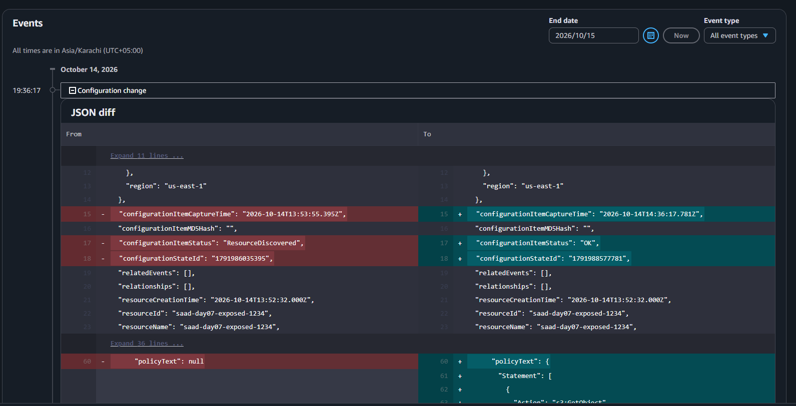
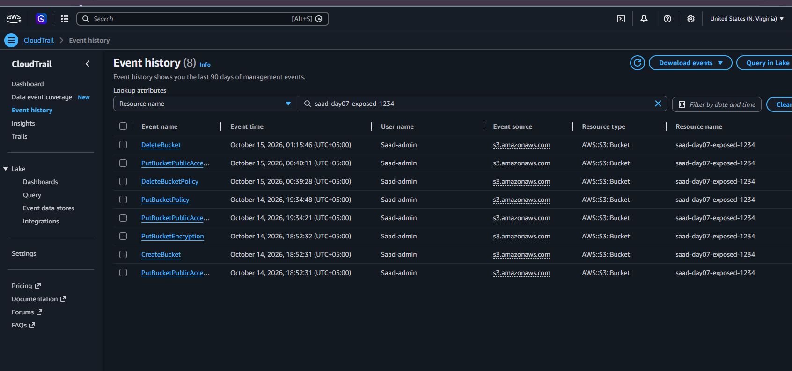
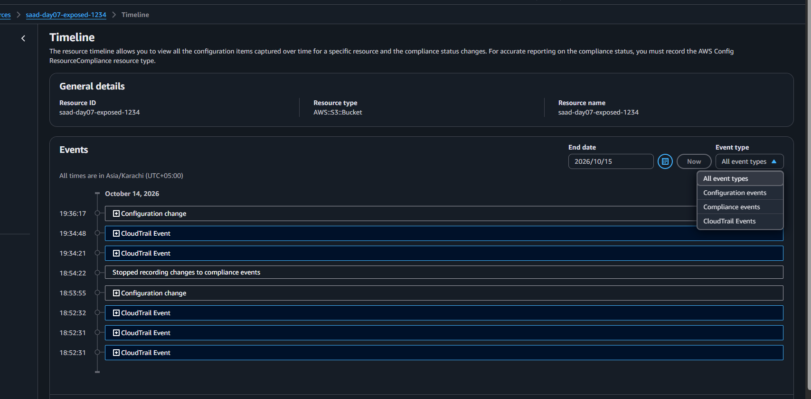
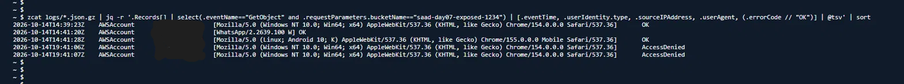
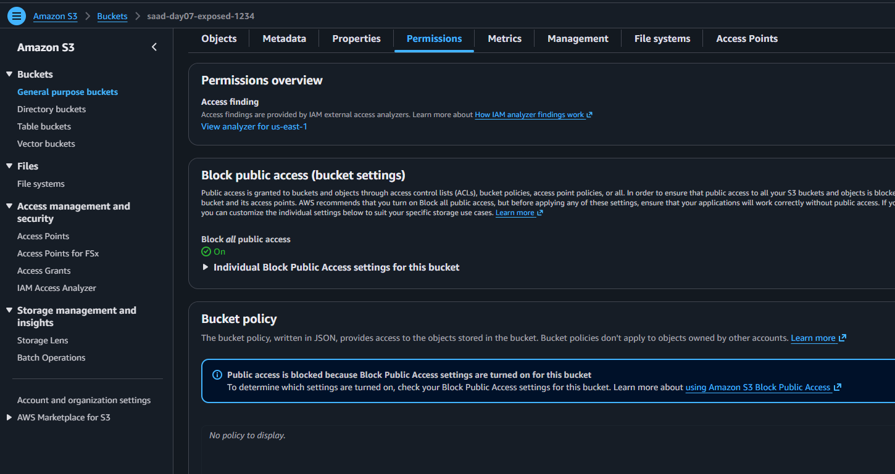

# Exposed S3 Bucket: Incident Investigation (Controlled Lab)

> **This is a controlled lab exercise.** I caused the exposure on purpose, using fake data in my own AWS account. All resources were deleted afterwards. No real data was involved.

## Summary

I created an S3 bucket containing a fake `customers.csv`, then made it publicly readable with a public-read bucket policy, while Block Public Access was off. Three anonymous reads succeeded within the first seven minutes. The exposure lasted 5 hours 4 minutes 40 seconds. I then investigated it as if I had found it afterwards, using AWS Config and CloudTrail, contained it, wrote this report, and deleted the resources.

**Key facts**

| | |
|---|---|
| Resource | S3 bucket `saad-day07-exposed-1234` (us-east-1), deleted after the lab |
| Cause | Bucket policy with `"Principal": "*"` and `s3:GetObject`, with no Block Public Access protection in place |
| Actor | IAM user `Saad-admin` |
| Exposure window | 19:34:48 to 00:39:28 PKT (5 h 4 min 40 s) |
| Successful anonymous reads | 3 (all in the first 7 minutes) |
| Data exposed | One fake CSV file. No real data. |

All times are PKT (UTC+05:00) unless stated. See [timeline.md](timeline.md) for PKT and UTC side by side.

## Who, what, when, where

- **Who:** IAM user `Saad-admin`. The source IP is hidden in this repo (`<MY_IP>`).
- **What:** Added a public-read bucket policy (`PutBucketPolicy`) to a bucket that had no Block Public Access protection.
- **When:** 14 Oct 2026, 19:34:48 PKT (14:34:48 UTC).
- **Where:** One S3 bucket in us-east-1.

## Tools and setup

| Tool | Used for |
|---|---|
| AWS CloudTrail management events | Who changed the bucket settings and when |
| CloudTrail data events (enabled for this one bucket only, before the incident) | Who read the file |
| AWS Config and rule `s3-bucket-public-read-prohibited` | Detection, and the before/after configuration |
| AWS CloudShell with `jq` | Searching the CloudTrail log files |

## Detection

AWS Config recorded the bucket's configuration change at 19:36:17 PKT, 1 minute 29 seconds after the policy was attached (`policyText` changed from `null` to the public policy). The rule `s3-bucket-public-read-prohibited` then showed the bucket as noncompliant. After containment it showed the bucket as compliant again.

The exact time of the noncompliant flag was not captured in a log (see Limitations).



The full policy is in [policy/public-read-policy.json](policy/public-read-policy.json).

## Investigation

### 1. Who changed the settings (CloudTrail management events)

Event history filtered by the bucket name shows every action was performed by `Saad-admin`:

| Time (PKT) | Event |
|---|---|
| 14 Oct 18:52:31 | `CreateBucket` and `PutBucketPublicAccessBlock` |
| 14 Oct 18:52:32 | `PutBucketEncryption` |
| 14 Oct 19:34:21 | `PutBucketPublicAccessBlock` |
| 14 Oct 19:34:48 | `PutBucketPolicy` (exposure starts) |
| 15 Oct 00:39:28 | `DeleteBucketPolicy` (exposure ends) |
| 15 Oct 00:40:11 | `PutBucketPublicAccessBlock` (all four settings turned on) |
| 15 Oct 01:15:46 | `DeleteBucket` |



### 2. What the bucket looked like before and after (AWS Config)

- Config's first snapshot of the bucket (18:53:55 PKT) already showed all four bucket-level Block Public Access settings as `false`. The Config diff at 19:36:17 PKT changed only the bucket policy.
- Account-level Block Public Access was also off.
- The ACL had only the bucket owner with full control. No public grant. The exposure came from the bucket policy alone.
- Default encryption was SSE-S3 (AES256), so anonymous reads could succeed.
- Server access logging was off. CloudTrail data events were the only record of reads.



### 3. Who read the file (CloudTrail data events)

Data events do not appear in CloudTrail Event history. They are only in the log files delivered to the trail's S3 bucket. I downloaded those files in CloudShell and filtered them:

```bash
zcat logs/*.json.gz | jq -r '.Records[]
  | select(.eventName=="GetObject" and .requestParameters.bucketName=="saad-day07-exposed-1234")
  | [.eventTime, .userIdentity.type, .sourceIPAddress, .userAgent, (.errorCode // "OK")]
  | @tsv' | sort
```

| Time (UTC) | User agent | Result |
|---|---|---|
| 14 Oct 14:39:23 | Windows Chrome | OK |
| 14 Oct 14:41:20 | WhatsApp | OK |
| 14 Oct 14:41:28 | Android Chrome | OK |
| 14 Oct 19:41:06 | Windows Chrome | AccessDenied |
| 14 Oct 19:41:07 | Windows Chrome | AccessDenied |



What the entries show:

- The requests had `userIdentity.type` of `AWSAccount` and no IAM user name. This is how an unauthenticated request looks in the log.
- All five entries came from the same source IP (hidden for privacy).
- The WhatsApp entry is consistent with WhatsApp fetching the link to build a preview when the link was shared in a chat. The link was never given to anyone else, but a third-party service still fetched the file.
- The two `AccessDenied` entries happened after containment. They were my own verification checks (same IP and browser), not an outside attempt.

## Impact

- **Confirmed:** 3 successful anonymous reads of `customers.csv`, all between 19:39:23 and 19:41:28 PKT.
- **Data:** fake. In a real incident this would be a data exposure and would need the data owner and legal or compliance teams.
- **Possible undercount:** reads served from a browser cache would not appear in CloudTrail.
- **Not exposed:** the policy allowed `GetObject` only. It did not allow listing the bucket or writing to it.

## Containment

I collected evidence first, so containment came after the investigation. This is why the exposure window is long. In a real incident, containment comes first.

1. 00:39:28: deleted the bucket policy (`DeleteBucketPolicy`). Public access stopped here.
2. 00:40:11: turned Block Public Access on for the bucket (all four settings `true`).
3. 00:41:06 and 00:41:07: opened the file URL anonymously again and got `AccessDenied`, confirming containment (recorded in the data events above).



## Cleanup

- Emptied and deleted the bucket (`DeleteBucket`, 01:15:46 PKT).
- Removed the bucket-specific data event selector from the trail.
- Turned account-level Block Public Access on.
- Deleted the downloaded log files from CloudShell.

## Lessons learned

1. **Turn on Block Public Access at account level.** It was off here, so nothing stopped a single policy from exposing the bucket. This is the most effective single control.
2. **Alert on risky changes.** Config noticed the change after 1 min 29 s, but nothing alerted anyone. An EventBridge rule or Config notification on `PutBucketPolicy` and public-access changes would shorten the time to respond.
3. **Record compliance history.** Config was not recording compliance changes, so I could not measure how long detection took. A detection metric needs that history.
4. **Enable data events before an incident.** Reads were only visible because data events were already on for this bucket. Anything before that point, including the original upload, is not logged.
5. **A secret URL is not a security control.** Nobody was given the URL, yet WhatsApp fetched the file. Public means anyone who finds or guesses the address, or whose service sees the link, can read it.
6. **Use safer ways to share.** Pre-signed URLs, IAM permissions, or CloudFront with a private bucket, rather than public buckets.
7. **Contain first in a real incident.** Evidence gathering is important, but in production the order is contain, then investigate.

## Limitations

- The exact time Config flagged the bucket as noncompliant was not recorded.
- Config showed a "stopped recording changes to compliance events" entry and no compliance history, so detection delay could not be measured.
- The count of 3 reads is a lower bound because of browser caching.
- One analyst, one fake file, one bucket. A real incident would involve far more log volume and would need tools such as Athena or a SIEM.

## Repository contents

| Path | What it is |
|---|---|
| `README.md` | This report |
| `timeline.md` | Full timeline in PKT and UTC |
| `Evidences/` | Redacted screenshots used in this report |
| `policy/public-read-policy.json` | The bucket policy that caused the exposure |

Account ID, access key ID, and my IP address were removed from all screenshots and text.
